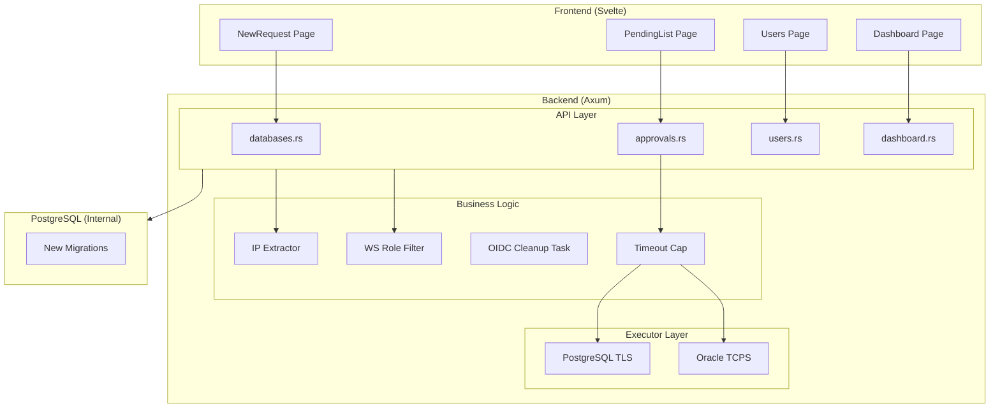
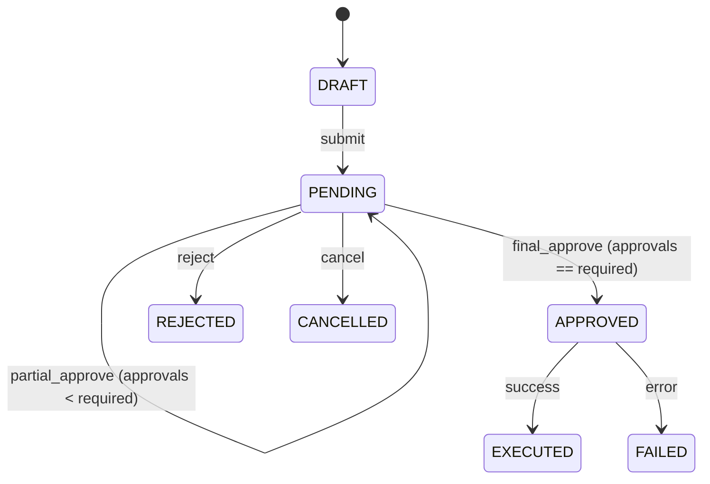

# Design Document — SECS Gap Fixes

## Overview

Tài liệu thiết kế cho việc sửa 16 lỗ hổng (gaps) trong hệ thống SECS. Các gaps bao gồm: endpoint thiếu cho Maker, credential rotation, role management UI, TLS enforcement, role-aware dashboard, IP audit, WebSocket filtering, multi-level approval, session TTL, timeout cap, và pending list filtering.

### Phạm vi thay đổi

| Layer | Thay đổi |
|-------|----------|
| Database Schema | Migration mới: `approval_levels_required`, `request_approvals` table, `ip_address` column, nullable `request_id` |
| Backend API | 3 endpoint mới, 5 endpoint sửa, 1 background task mới |
| Backend Logic | Executor TLS, dashboard filtering, WS filtering, OIDC cleanup, timeout cap |
| Frontend | 4 page/component mới/sửa |

### Nguyên tắc thiết kế

- **Backward compatible**: Không break API contract hiện có
- **Incremental migration**: Mỗi gap có thể deploy độc lập
- **Defense in depth**: Enforce ở cả DB constraint và application layer
- **Fail secure**: TLS enforcement không fallback, audit ghi "unknown" thay vì skip

## Architecture

### High-Level Component Diagram



### Chiến lược triển khai

1. **Phase 1 (Critical)**: TLS enforcement (Req 5, 6), Timeout cap (Req 15)
2. **Phase 2 (High)**: Maker DB endpoint (Req 1), Credential rotation (Req 2), Multi-level approval (Req 10), EXECUTING audit (Req 11), IP audit (Req 8)
3. **Phase 3 (Medium)**: Dashboard role-aware (Req 7), WS filtering (Req 9), Pending list filter (Req 13), Role audit (Req 12), OIDC TTL (Req 14)
4. **Phase 4 (Low)**: Frontend UI (Req 3, 4, 16)

## Components and Interfaces

### 1. Maker Database List Endpoint (Req 1)

**File**: `backend/src/api/databases.rs`

```rust
/// GET /api/v1/databases/my-permissions — Maker xem databases mình có quyền.
pub async fn list_my_databases(
    State(state): State<AppState>,
    RequireMaker(claims): RequireMaker,
) -> Result<Json<Vec<MakerDatabaseResponse>>, AppError>
```

**Response DTO** (không chứa credentials, timeout, timestamps):
```rust
pub struct MakerDatabaseResponse {
    pub id: Uuid,
    pub name: String,
    pub db_type: DbType,
    pub host: String,
    pub port: i32,
    pub database_name: String,
    pub schema_name: Option<String>,
}
```

**DB Query** (`db/databases.rs`):
```sql
SELECT dc.id, dc.name, dc.db_type, dc.host, dc.port, dc.database_name, dc.schema_name
FROM database_connections dc
INNER JOIN user_db_permissions udp ON dc.id = udp.database_id
WHERE udp.user_id = $1 AND dc.is_active = true
ORDER BY dc.name ASC
LIMIT 100
```

### 2. Credential Update API (Req 2)

**File**: `backend/src/api/databases.rs`

```rust
/// PATCH /api/v1/databases/:id/credentials — Admin rotate credentials.
pub async fn update_credentials(
    State(state): State<AppState>,
    RequireAdmin(claims): RequireAdmin,
    Path(id): Path<Uuid>,
    Json(body): Json<UpdateCredentialsBody>,
) -> Result<StatusCode, AppError>  // Returns 204 No Content

#[derive(Debug, Deserialize, Validate)]
pub struct UpdateCredentialsBody {
    #[validate(length(min = 1, max = 128))]
    pub username: String,
    #[validate(length(min = 1, max = 256))]
    pub password: String,
}
```

**Flow**:
1. Validate body (username 1-128, password 1-256, non-empty)
2. Verify database exists → 404 if not
3. Encrypt new credentials with AES-256-GCM
4. Update `encrypted_credentials` in DB
5. Write audit log: action="CREDENTIAL_ROTATED", detail="database_id: {id}" (no credential values)
6. Return 204

### 3. IP Address Extraction (Req 8)

**File mới**: `backend/src/api/ip_extractor.rs`

```rust
/// Extract client IP with precedence:
/// 1. X-Forwarded-For (first IP in comma-separated list)
/// 2. X-Real-IP
/// 3. Direct connection address
/// 4. Fallback: "unknown"
pub fn extract_client_ip(headers: &HeaderMap, conn_info: &ConnectInfo<SocketAddr>) -> String
```

Hàm này sẽ được gọi từ mọi handler cần ghi audit log. IP được truncate ở 45 chars (hỗ trợ IPv6).

### 4. PostgreSQL TLS Enforcement (Req 5)

**File**: `backend/src/executor/postgres.rs`

Thay đổi `build_connection_string`:
```rust
fn build_connection_string(/* ... */) -> String {
    // THAY ĐỔI: sslmode=prefer → sslmode=require
    format!(
        "postgres://{}:{}@{}:{}/{}?sslmode=require",
        urlencoding::encode(username),
        urlencoding::encode(password),
        host, port, database_name
    )
    // ... schema_name append
}
```

Không cần thay đổi logic khác — khi `sslmode=require` được set và server không hỗ trợ TLS, `sqlx` sẽ tự return error `ConnectionFailed` mà không fallback.

### 5. Oracle TLS Enforcement (Req 6)

**File**: `backend/src/executor/oracle.rs`

Thay đổi `build_connect_string` sang TNS descriptor format với TCPS:
```rust
fn build_connect_string(host: &str, port: i32, service_name: &str) -> String {
    // THAY ĐỔI: EZConnect → TNS descriptor with TCPS
    format!(
        "(DESCRIPTION=(ADDRESS=(PROTOCOL=TCPS)(HOST={host})(PORT={port}))\
         (CONNECT_DATA=(SERVICE_NAME={service_name}))\
         (SECURITY=(SSL_SERVER_DN_MATCH=YES)))"
    )
}
```

### 6. Role-Aware Dashboard (Req 7)

**File**: `backend/src/api/dashboard.rs`

Redesign `get_stats` handler:
```rust
pub async fn get_stats(
    State(state): State<AppState>,
    RequireAuth(claims): RequireAuth,
) -> Result<Json<DashboardStats>, AppError> {
    // Xác định highest-priority role: Admin > Checker > Maker
    let effective_role = determine_effective_role(&claims.roles);
    match effective_role {
        Some(Role::Admin) => get_admin_stats(&state.db).await,
        Some(Role::Checker) => get_checker_stats(&state.db, claims.user_id).await,
        Some(Role::Maker) => get_maker_stats(&state.db, claims.user_id).await,
        None => Ok(Json(DashboardStats::empty())),
    }
}
```

**Dashboard Stats DTO mở rộng**:
```rust
#[derive(Debug, Serialize)]
pub struct DashboardStats {
    pub total_requests: i64,
    pub pending_requests: i64,
    pub approved_requests: i64,
    pub executed_requests: i64,
    pub failed_requests: i64,
    pub rejected_requests: i64,
    pub cancelled_requests: i64,
    // Checker-specific
    pub pending_for_review: Option<i64>,  // pending excluding own
    pub total_reviewed: Option<i64>,
    pub total_approved_by_me: Option<i64>,
    pub total_rejected_by_me: Option<i64>,
}
```

### 7. WebSocket Role-Based Filtering (Req 9)

**File**: `backend/src/ws/mod.rs`

Thay đổi: thêm `created_by` vào `Notification`, lưu `claims` khi upgrade, filter trong loop.

```rust
async fn handle_ws_connection(
    mut socket: WebSocket,
    mut rx: broadcast::Receiver<Notification>,
    claims: Claims,
    pool: PgPool,  // để query approval history cho Checker
) {
    loop {
        tokio::select! {
            result = rx.recv() => {
                match result {
                    Ok(notification) => {
                        if should_forward(&notification, &claims, &pool).await {
                            // serialize and send
                        }
                    }
                    // ...
                }
            }
            // ...
        }
    }
}

/// Xác định notification có nên forward cho user này không.
async fn should_forward(
    notification: &Notification,
    claims: &Claims,
    pool: &PgPool,
) -> bool {
    // Admin → always forward
    if claims.has_role(&Role::Admin) { return true; }
    
    // Check created_by field
    let created_by = match notification.created_by {
        Some(id) => id,
        None => return false,  // discard if missing created_by for non-Admin
    };
    
    let mut forward = false;
    
    // Maker rule: forward if created_by == user
    if claims.has_role(&Role::Maker) && created_by == claims.user_id {
        forward = true;
    }
    
    // Checker rule: NEW_REQUEST or previously reviewed
    if claims.has_role(&Role::Checker) {
        if notification.notification_type == NotificationType::NewRequest {
            forward = true;
        }
        // Check if checker has approved/rejected this request before
        // (query audit_log for this checker + request_id)
    }
    
    forward
}
```

### 8. Multi-Level Approval (Req 10)

**Thiết kế state machine mở rộng**:



**Bảng mới**: `request_approvals`
```sql
CREATE TABLE request_approvals (
    id UUID PRIMARY KEY DEFAULT gen_random_uuid(),
    request_id UUID NOT NULL REFERENCES sql_requests(id),
    approver_id UUID NOT NULL REFERENCES users(id),
    level INT NOT NULL,
    approved_at TIMESTAMPTZ NOT NULL DEFAULT NOW(),
    UNIQUE(request_id, approver_id)  -- mỗi checker chỉ approve 1 lần
);
```

**Field mới trên `database_connections`**:
```sql
ALTER TABLE database_connections 
ADD COLUMN approval_levels_required INT NOT NULL DEFAULT 1 
CHECK (approval_levels_required BETWEEN 1 AND 5);
```

**Field mới trên `sql_requests`** (snapshot threshold):
```sql
ALTER TABLE sql_requests 
ADD COLUMN approval_levels_required INT NOT NULL DEFAULT 1;
```

**Approve flow thay đổi** (`api/approvals.rs`):
1. Validate status == PENDING
2. Validate 4-eyes (creator != approver)
3. Validate approver chưa approve request này trước đó (query `request_approvals`)
4. Insert vào `request_approvals` (level = current_count + 1)
5. Count total approvals cho request
6. Nếu count == `sql_requests.approval_levels_required` → transition APPROVED, trigger execution
7. Nếu count < required → giữ PENDING, broadcast partial approval notification

### 9. EXECUTING Audit State (Req 11)

Thêm audit entry "EXECUTING" trước khi gọi executor trong `execute_sql_async`:

```rust
async fn execute_sql_async(/* ... */) {
    // ... decrypt credentials ...
    
    // INSERT EXECUTING audit TRƯỚC KHI execute
    let _ = db::audit::insert(pool, request_id, "EXECUTING", actor_id, None, None, ip_address.as_deref()).await;
    
    // Execute SQL
    match executor::execute_sql(/* ... */).await {
        Ok(result) => { /* EXECUTED */ }
        Err(e) => { /* FAILED */ }
    }
}
```

### 10. Role Change Audit Logging (Req 12)

Thay đổi `update_user` handler để ghi audit:

```rust
pub async fn update_user(/* ... */) -> Result<Json<UserDetailResponse>, AppError> {
    let ip = extract_client_ip(&headers, &conn_info);
    
    // Lấy old state TRƯỚC khi update
    let old_roles = db::users::get_user_roles(&state.db, user_id).await?;
    let old_active = /* query current is_active */;
    
    // ... perform updates ...
    
    // Audit ROLE_CHANGED nếu roles thực sự thay đổi
    if let Some(ref new_roles) = body.roles {
        if roles_changed(&old_roles, new_roles) {
            db::audit::insert_admin_action(
                &state.db, "ROLE_CHANGED", claims.user_id,
                &format!("old_roles: {:?}, new_roles: {:?}", old_roles, new_roles),
                &ip,
            ).await?;
        }
    }
    
    // Audit USER_STATUS_CHANGED nếu status thay đổi
    if let Some(new_active) = body.is_active {
        if new_active != old_active {
            db::audit::insert_admin_action(
                &state.db, "USER_STATUS_CHANGED", claims.user_id,
                &format!("old_status: {}, new_status: {}",
                    if old_active { "active" } else { "inactive" },
                    if new_active { "active" } else { "inactive" }),
                &ip,
            ).await?;
        }
    }
}
```

**Schema change**: `audit_log.request_id` → nullable:
```sql
ALTER TABLE audit_log ALTER COLUMN request_id DROP NOT NULL;
```

**Hàm mới** `db::audit::insert_admin_action`:
```rust
pub async fn insert_admin_action(
    pool: &PgPool,
    action: &str,
    actor_id: Uuid,
    detail: &str,
    ip_address: &str,
) -> Result<AuditLog, sqlx::Error>
```

### 11. Pending List Exclude Checker's Own (Req 13)

Thay đổi `db::requests::list_pending` → nhận `checker_user_id` parameter:

```rust
pub async fn list_pending(pool: &PgPool, checker_user_id: Uuid) -> Result<Vec<SqlRequest>, sqlx::Error> {
    sqlx::query_as::<_, SqlRequest>(
        r#"SELECT ... FROM sql_requests
           WHERE status = 'PENDING' AND created_by != $1
           ORDER BY submitted_at ASC"#,
    )
    .bind(checker_user_id)
    .fetch_all(pool)
    .await
}
```

### 12. OIDC Session TTL (Req 14)

**Config mới**:
```rust
pub struct Config {
    // ... existing fields ...
    /// OIDC session TTL in seconds (default: 300, range: 60-900)
    pub oidc_session_ttl_secs: u64,
    /// Cleanup interval in seconds (default: 60, range: 10-300)
    pub oidc_cleanup_interval_secs: u64,
}
```

**Session store thay đổi** — thêm timestamp:
```rust
pub struct TimestampedSession {
    pub session: OidcSession,
    pub created_at: Instant,
}
pub type OidcSessionStore = Arc<RwLock<HashMap<String, TimestampedSession>>>;
```

**Background task** (spawn trong `main.rs`):
```rust
async fn oidc_session_cleanup(store: OidcSessionStore, ttl: Duration, interval: Duration) {
    let mut ticker = tokio::time::interval(interval);
    loop {
        ticker.tick().await;
        let now = Instant::now();
        let mut sessions = store.write().await;
        sessions.retain(|_, v| now.duration_since(v.created_at) < ttl);
    }
}
```

### 13. Timeout Cap (Req 15)

Thay đổi trong `execute_sql_async`:
```rust
// Apply global cap: effective_timeout = min(db_timeout, global_cap)
let db_timeout_secs = db_conn.timeout_secs as u64;
let global_cap = config.sql_execution_timeout_secs;
let effective_timeout = Duration::from_secs(db_timeout_secs.min(global_cap));
```

### 14. Frontend Changes (Req 3, 4, 16)

**Users.svelte** — thêm:
- Role checkboxes panel (ADMIN, MAKER, CHECKER)
- Activate/Deactivate toggle với confirmation dialog
- Self-deactivation check (so sánh user.id với current auth user)

**PendingList.svelte** — thêm:
- Filter dropdown (by database) — client-side filter
- Text search input (filter by description)
- Sort options (newest/oldest)
- Count display: "Showing X of Y"
- Session storage persistence

**NewRequest.svelte** — thay đổi:
- Gọi `GET /api/v1/databases/my-permissions` thay vì `GET /api/v1/databases`

## Data Models

### Database Schema Changes (Migration 007)

```sql
-- 007_gap_fixes.sql

-- Req 10: Multi-level approval support
ALTER TABLE database_connections 
ADD COLUMN approval_levels_required INT NOT NULL DEFAULT 1 
CHECK (approval_levels_required BETWEEN 1 AND 5);

-- Req 10: Snapshot threshold on request
ALTER TABLE sql_requests 
ADD COLUMN approval_levels_required INT NOT NULL DEFAULT 1;

-- Req 10: Approval tracking table
CREATE TABLE request_approvals (
    id UUID PRIMARY KEY DEFAULT gen_random_uuid(),
    request_id UUID NOT NULL REFERENCES sql_requests(id),
    approver_id UUID NOT NULL REFERENCES users(id),
    level INT NOT NULL,
    approved_at TIMESTAMPTZ NOT NULL DEFAULT NOW(),
    UNIQUE(request_id, approver_id)
);

CREATE INDEX idx_request_approvals_request_id ON request_approvals(request_id);

-- Req 12: Make request_id nullable for admin audit entries
ALTER TABLE audit_log ALTER COLUMN request_id DROP NOT NULL;

-- Req 8: Ensure ip_address column exists (already in schema, just ensure NOT NULL default)
-- ip_address already exists as Optional<String> — no schema change needed
```

### Rust Model Changes

**`models/notification.rs`** — thêm `created_by`:
```rust
pub struct Notification {
    pub notification_type: NotificationType,
    pub request_id: Uuid,
    pub created_by: Option<Uuid>,   // NEW: cho WS filtering
    pub database_name: Option<String>,
    pub actor_id: Option<Uuid>,
    pub rows_affected: Option<i64>,
    pub detail: Option<String>,
}
```

**`models/approval.rs`** — thêm `AuditAction` variants:
```rust
pub enum AuditAction {
    // ... existing ...
    Executing,        // Req 11
    RoleChanged,      // Req 12
    UserStatusChanged,// Req 12
    CredentialRotated,// Req 2
}
```

**Model mới** — `models/request_approval.rs`:
```rust
#[derive(Debug, Clone, Serialize, Deserialize, sqlx::FromRow)]
pub struct RequestApproval {
    pub id: Uuid,
    pub request_id: Uuid,
    pub approver_id: Uuid,
    pub level: i32,
    pub approved_at: DateTime<Utc>,
}
```

## Correctness Properties

*A property is a characteristic or behavior that should hold true across all valid executions of a system — essentially, a formal statement about what the system should do. Properties serve as the bridge between human-readable specifications and machine-verifiable correctness guarantees.*

### Property 1: Database permission filter returns only permitted active databases

*For any* set of database connections and user permissions, calling the Maker database list function SHALL return only databases where `is_active = true` AND the user has a corresponding permission entry, ordered by name ascending, with at most 100 results.

**Validates: Requirements 1.1, 1.7**

### Property 2: Response DTO excludes sensitive fields

*For any* valid `DatabaseConnection` record, converting it to `MakerDatabaseResponse` SHALL NOT include `encrypted_credentials`, `timeout_secs`, `is_active`, `created_at`, or `updated_at` fields in the serialized output.

**Validates: Requirements 1.3**

### Property 3: Credential encryption round-trip

*For any* valid username (1-128 chars) and password (1-256 chars), encrypting then decrypting with the same key SHALL produce the original username and password.

**Validates: Requirements 2.1**

### Property 4: Credential validation rejects invalid inputs

*For any* string where username length is 0 or >128, OR password length is 0 or >256, the credential update validation SHALL reject the input with a descriptive error.

**Validates: Requirements 2.2, 2.3**

### Property 5: Audit log never contains credential values

*For any* credential rotation event, the audit log detail field SHALL NOT contain the username or password values that were submitted.

**Validates: Requirements 2.6**

### Property 6: PostgreSQL connection string enforces TLS

*For any* valid combination of host, port, database_name, username, and password, the generated PostgreSQL connection string SHALL contain `sslmode=require` and SHALL NOT contain `sslmode=prefer`.

**Validates: Requirements 5.1, 5.2**

### Property 7: Oracle connection string uses TCPS protocol

*For any* valid combination of host, port, and service_name, the generated Oracle connect descriptor SHALL contain `PROTOCOL=TCPS` and `SECURITY=(SSL_SERVER_DN_MATCH=YES)`.

**Validates: Requirements 6.1, 6.2**

### Property 8: Role-based dashboard stats correctness

*For any* set of SQL requests with varying owners and statuses, and *for any* authenticated user:
- If the user's effective role is Admin: stats SHALL equal global counts across all requests
- If the user's effective role is Checker: pending_for_review SHALL exclude requests created by the user
- If the user's effective role is Maker: all counts SHALL be filtered to only that user's own requests
- If the user has no role: all counts SHALL be zero

**Validates: Requirements 7.1, 7.2, 7.3, 7.4, 7.5**

### Property 9: IP address extraction follows precedence

*For any* combination of HTTP headers (X-Forwarded-For, X-Real-IP) and connection address, the extracted IP SHALL follow the precedence: X-Forwarded-For first entry > X-Real-IP > connection address > "unknown". The result SHALL be at most 45 characters.

**Validates: Requirements 8.1, 8.2, 8.3**

### Property 10: WebSocket Maker filter correctness

*For any* notification and a connected user with only Maker role, the notification SHALL be forwarded if and only if `notification.created_by == user.id`.

**Validates: Requirements 9.2**

### Property 11: WebSocket Checker filter correctness

*For any* notification and a connected user with only Checker role, the notification SHALL be forwarded if and only if: (a) it is of type NEW_REQUEST, OR (b) the Checker has previously approved or rejected the same request_id.

**Validates: Requirements 9.3**

### Property 12: WebSocket Admin passthrough

*For any* notification and a connected user with Admin role, the notification SHALL always be forwarded regardless of content.

**Validates: Requirements 9.5**

### Property 13: Multi-level approval state machine correctness

*For any* request targeting a database with `approval_levels_required = N` (1 ≤ N ≤ 5), the request SHALL remain in PENDING status until exactly N distinct approvals are recorded, after which it SHALL transition to APPROVED.

**Validates: Requirements 10.2, 10.4, 10.5**

### Property 14: Four-eyes principle per approval level

*For any* request and *for any* sequence of approval attempts, no single user SHALL provide more than one approval for the same request, AND the request creator SHALL never appear as an approver at any level.

**Validates: Requirements 10.6, 10.7**

### Property 15: Approval threshold snapshot isolation

*For any* request that enters PENDING status with `approval_levels_required = N`, changing the database's `approval_levels_required` after submission SHALL NOT affect the number of approvals needed for that request — it SHALL still require exactly N approvals.

**Validates: Requirements 10.8**

### Property 16: EXECUTING audit entry precedes execution result

*For any* SQL execution (success or failure), an audit entry with action "EXECUTING" SHALL exist with a timestamp less than or equal to the corresponding "EXECUTED" or "FAILED" audit entry timestamp for the same request.

**Validates: Requirements 11.1, 11.3**

### Property 17: Role change audit captures old and new state

*For any* role update where the new roles differ from the old roles, an audit entry with action "ROLE_CHANGED" SHALL be created containing both the old roles and new roles in its detail field.

**Validates: Requirements 12.1**

### Property 18: No-op update produces no audit entry

*For any* user update request where the submitted roles are identical to the current roles AND the submitted is_active is identical to the current is_active, NO audit entry SHALL be created.

**Validates: Requirements 12.6**

### Property 19: Pending list excludes Checker's own requests

*For any* set of PENDING requests and *for any* Checker user, the pending list returned to that Checker SHALL NOT contain any request where `created_by` equals the Checker's user_id.

**Validates: Requirements 13.1**

### Property 20: OIDC session cleanup correctness

*For any* set of sessions with varying ages, after cleanup with TTL=T, all sessions with age > T SHALL be removed AND all sessions with age ≤ T SHALL be retained.

**Validates: Requirements 14.2, 14.3**

### Property 21: Effective timeout is minimum of database and global cap

*For any* database-specific timeout D and global cap G (both positive integers), the effective timeout used for execution SHALL equal min(D, G).

**Validates: Requirements 15.1, 15.3**

### Property 22: Frontend text search filters by description content

*For any* list of pending requests and *for any* search term, the filtered result SHALL contain only requests whose description contains the search term (case-insensitive).

**Validates: Requirements 16.2**

### Property 23: Frontend sort produces correct ordering

*For any* list of pending requests, sorting by submission date "newest first" SHALL produce a list where each item's submitted_at is greater than or equal to the next item's submitted_at, and "oldest first" SHALL produce the reverse.

**Validates: Requirements 16.3**

## Error Handling

### Error Types mới/mở rộng

| Error | HTTP Status | Trigger |
|-------|-------------|---------|
| `AppError::DuplicateApproval` | 409 Conflict | Checker đã approve request này rồi |
| `AppError::InsufficientApprovals` | N/A (internal) | Dùng để track partial approval |
| `AppError::TlsRequired` | N/A (executor) | PostgreSQL/Oracle TLS handshake fail |
| `AppError::SessionExpired` | 401 | OIDC state không match session |

### Error Handling Strategy

1. **TLS Errors** (Req 5, 6): Executor trả về `ExecutorError::ConnectionFailed` với message chỉ ra TLS issue. Không retry, không fallback.

2. **Multi-Level Approval Errors** (Req 10):
   - Duplicate approval → 409 với message "You have already approved this request"
   - Self-approval → 403 với message "Cannot approve your own request (four-eyes principle)"
   - Partial approval (count < required) → 200 với response chỉ ra progress "1/2 approvals"

3. **Credential Validation** (Req 2):
   - Empty username/password → 400 với field-specific error
   - Length violation → 400 với constraint description
   - DB not found → 404

4. **IP Extraction** (Req 8): Không bao giờ fail — fallback "unknown" đảm bảo audit log luôn có giá trị.

5. **OIDC Session** (Req 14): Expired/missing session → 401 Unauthorized. Cleanup task chạy silent — lỗi chỉ log, không crash.

6. **Timeout Cap** (Req 15): Không error — luôn dùng min(db, global) một cách im lặng.

## Testing Strategy

### Property-Based Testing

**Library**: `proptest` (Rust) — phổ biến nhất cho Rust PBT, tích hợp tốt với cargo test.

**Configuration**:
- Minimum 100 iterations per property test (`PROPTEST_CASES=100`)
- Tag format: `// Feature: secs-gap-fixes, Property {N}: {title}`

**Properties áp dụng PBT** (pure function / clear input-output):

| Property | Test Module | Strategy |
|----------|-------------|----------|
| P1: Permission filter | `tests/prop_databases.rs` | Generate random Vec<Database> + Vec<Permission>, verify filter |
| P2: DTO exclusion | `tests/prop_databases.rs` | Generate random DatabaseConnection, check serialized JSON |
| P3: Credential round-trip | `tests/prop_encryption.rs` | Generate random (username, password), encrypt/decrypt |
| P4: Credential validation | `tests/prop_validation.rs` | Generate random strings, check accept/reject |
| P5: Audit no credentials | `tests/prop_audit.rs` | Generate random credentials, verify absence in detail |
| P6: PG connection string | `tests/prop_executor.rs` | Generate random params, check `sslmode=require` |
| P7: Oracle connect string | `tests/prop_executor.rs` | Generate random params, check `PROTOCOL=TCPS` |
| P8: Dashboard stats | `tests/prop_dashboard.rs` | Generate random request sets, verify per-role counts |
| P9: IP extraction | `tests/prop_ip.rs` | Generate random header combos, verify precedence |
| P10-12: WS filtering | `tests/prop_ws.rs` | Generate random notifications + roles, verify filter |
| P13: Approval state machine | `tests/prop_approval.rs` | Generate random N + approval sequences |
| P14: Four-eyes | `tests/prop_approval.rs` | Generate random approver lists, verify constraints |
| P19: Pending exclusion | `tests/prop_requests.rs` | Generate random requests + checker_id, verify exclusion |
| P20: OIDC cleanup | `tests/prop_oidc.rs` | Generate random sessions + ages, verify cleanup |
| P21: Timeout cap | `tests/prop_timeout.rs` | Generate random (db_timeout, global_cap), verify min |

### Unit Tests (Example-Based)

| Component | Test Cases |
|-----------|-----------|
| Credential API | 404 for non-existent DB, 403 for non-Admin, 204 success, 400 validation |
| EXECUTING audit | Verify actor_id propagation, timestamp ordering |
| Role audit | Separate entries for role+status change, no entry for no-op |
| Session TTL | Config validation range 60-900, cleanup interval 10-300 |
| Approval threshold snapshot | Change config after submit, verify old threshold used |

### Integration Tests

| Scenario | Description |
|----------|-------------|
| TLS PostgreSQL | Connect to non-TLS PostgreSQL → verify ConnectionFailed |
| Multi-level approval flow | Full 2-level approval → execution |
| WebSocket filtering | Connect as Maker, verify only own notifications received |
| OIDC session expiry | Wait > TTL, verify callback returns 401 |

### Frontend Tests (Vitest + Testing Library)

| Component | Tests |
|-----------|-------|
| PendingList filters | Text search, database filter, sort order, count display |
| Users role panel | Checkbox state, save API call, self-deactivation prevention |
| NewRequest DB dropdown | Calls correct endpoint, handles empty list |
